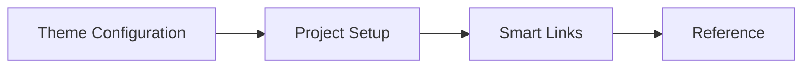

# justdocs

Reusable MkDocs theme package with a project recipe generator and deterministic
Smart Links.

| Area | Page |
| --- | --- |
| Theme options | Theme Configuration |
| Project recipes | Project Setup |
| Linker behavior | Smart Links |
| Package contracts | Reference |

## Runtime Features

| Feature | Surface |
| --- | --- |
| Layout | Topbar, primary navigation, content column, right page sections, and mobile navigation. |
| Theme mode | Light and dark datasets backed by local storage. |
| Search | Client search UI backed by MkDocs `search/search_index.json`. |
| Tables | Header labels copied into mobile table cells. |
| Code blocks | Highlight.js plus copy button plugin. |
| Mermaid | Bundled Mermaid rendered after load and theme changes. |
| Sidebars | Pointer, keyboard, collapse, restore, and drawer interactions. |
| Preferences | Density, content width, and motion selections. |

## Required MkDocs Plugins

```yaml
plugins:
  - search
  - justdocs-linker
```

## Mermaid Exercise



## Python API Exercise

```python
from justdocs.paths import theme_dir

print(theme_dir())
```

## Table Exercise

| Contract | Runtime |
| --- | --- |
| Theme Configuration | CSS tokens and `window.JUSTDOCS` config |
| Project Setup | Generated `Justfile` recipes |
| Smart Links | Pre-render Markdown transform |
